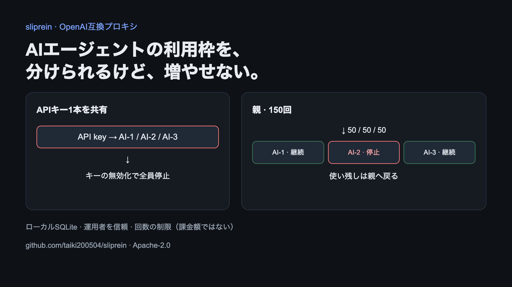

[English](README.md) | [日本語](README.ja.md) | [简体中文](README.zh-CN.md)

# sliprein

AIエージェントの利用枠を、分けられるけど増やせないものに。

OpenAI互換APIの前段に置く、ローカルの呼び出し回数管理プロキシです。試作段階で、本番利用者も独立したセキュリティ監査もまだありません。



- 親の利用枠を、子エージェントへ分割。
- 1本だけ停止し、使い残しを親へ戻す。
- 他の枝は、それぞれの枠で動き続ける。

## クイックスタート

```sh
# Node.js 24.x; UPSTREAM_API_KEY must already be set privately
npm ci --omit=dev
npm run -s sliprein -- issue agent-1 --calls 100
npm run -s sliprein -- token agent-1
npm run -s sliprein -- serve --upstream https://api.openai.com
```

3つ目のコマンドが出すトークンをSDKのAPIキーにし、`base_url` を `http://127.0.0.1:8787/v1` にします。上流APIキーはエージェントに渡さないでください。npm未公開のため、このチェックアウトから実行します。実行時の追加依存はゼロ。BSV SDKは開発用だけです。

## 仮想キーとの違い

既存の仮想キー製品にも、個別停止や共有・階層予算があります。slipreinの焦点は、**エージェント自身が残り回数を子へ分ける**操作です。合計・権限・有効期限を増やせず、枝の停止で使い残しが親へ一度だけ戻ります。個別停止自体が独自機能という意味ではありません。

## CLI

```sh
npm run -s sliprein -- delegate agent-1 worker --calls 25
npm run -s sliprein -- token worker
npm run -s sliprein -- stop worker
npm run -s sliprein -- status
```

## 信頼の境界と限界

運用者・ホスト・SQLite・TLSの境界・上流事業者を信頼します。運用者は利用枠を書き換え、上流キーへアクセスできます。トークンは所持の証明であり、本人性や意図の証明ではありません。プロンプト注入の防止、ツールの隔離、トークン課金の上限、受付済み呼び出しの取消はできません。上流応答ヘッダ受信前の接続失敗・タイムアウトは1回分を返却し、ヘッダ受信後の失敗（エラー応答・リダイレクト・ストリーム切断）は1回に数えます。停止前に始まったストリームは継続します。上流が返す機微情報も、そのまま通過します。

## スケールの上限

単一プロセスとローカルSQLiteが前提です。同期の永続書き込みは直列化され、イベントループを止めます。**水平分散やネットワークファイルシステムの共有は未対応です。** 独立した1万導入はそれぞれ別の状態を持ち、1台で1万人を処理できる意味ではありません。既定は本文64 KiB、IP毎秒200件、エージェント毎秒100受付、処理中200件、クライアント接続512本、上流接続64本、上流全体120秒（接続から本文完了まで）。プログラムから設定変更できますが、増やす前に計測してください。TLS・全体の攻撃対策・ディスク監視・バックアップ・更新配布は運用者が担います。

[Audit / 实测 / 実測](docs/SCALING_AUDIT.md) · `node scripts/load.mjs` (50 / 200 concurrent clients, local mock upstream; rps, p50/p99, errors). Results are local observations, not an SLA.

## よくある質問

**対応APIは？** `POST /v1/chat/completions`、`/v1/embeddings`、`/v1/responses` と `GET /v1/models`。JSONとSSEに対応し、他の経路やクエリ文字列は拒否します。上流には通常のパス接頭辞を指定できますが、標準OpenAIでは `/v1` を付けません。

**停止・委譲は？** 下のCLI、またはトークン認証の `POST /delegate`（`name`、`calls`、任意の `scope`・`expiresAt`）と `POST /stop`（`{}`）を使います。管理APIは上流回数を消費しません。権限ビットはchat=1、embeddings=2、responses=4、models=8。祖先の深さは最大8です。

**外部へ公開できる？** 既定は `127.0.0.1` 限定。明示的な `--host 0.0.0.0` で全IPv4へ公開し、警告を表示します。信頼する前段プロキシでTLSとアクセス制御を設定してください。`~/.sliprein`（`--state`で変更可）はエージェントへ渡さないでください。

**/healthz は何を見る？** 利用枠を消費しないプロセスの生存確認のみ。上流の準備状態やDBの整合性は確認しません。

**履歴の保存期間は？** 有効な枠の履歴・nonceは削除しません。期限終了から24時間後に、件数を制限して定期削除します。証跡が必要なら先に書き出してください。枠・精算メタデータ、WAL、バックアップは別途保持管理が必要です。トークンは停止・失効・枠切れまで再利用できます。

**エラーから秘密が漏れる？** プロキシのエラーは一般化し、クライアントの認証・hop-by-hopヘッダを上流へ転送しません。上流の本文は通過するため、上流自身の情報開示は制御外です。

旧版でDBファイルの権限が広くなっていた場合は、信頼する所有者がバックアップ後に権限を狭めてから更新してください。公開権限のDBやシンボリックリンクは拒否します。

[Security](SECURITY.md) · [Contributing](CONTRIBUTING.md) · [Changelog](CHANGELOG.md) · [Release / provenance](docs/RELEASING.md) · Apache-2.0

## 研究

任意の[BSV authority UTXO研究](research/authority-utxo/)は、コベナンツによる権限管理を扱います。既定のSQLiteプロキシとは別で、この版をトラストレスにするものではありません。実ネットワークの確定性、外部APIの副作用、敵対者の前提には未解決点があります。

トークン単独の有効期限は `sliprein token worker --ttl 3600`（秒、エージェントの期限内）で指定します。省略時は利用枠の期限に従います。`sliprein token revoke worker` はそのエージェントの既存トークンをすべて失効し、次の呼び出しから401を返します。他のエージェントや利用枠は停止せず、新しいトークンの発行も可能です。

直接公開する場合は `trustProxy: false`（CLI既定、`--trust-proxy false`）のままにし、転送ヘッダを無視します。IPv6のレート制限は/64単位です。リバースプロキシ配下の場合だけ `--trust-proxy true`（APIでは `trustProxy: true`）を明示し、`X-Forwarded-For` の最後のホップが有効なIPなら使用します。プロキシが実際の接続元IPを上書きまたは末尾に追加し、クライアントからゲートウェイへの直接接続を遮断してください。本文読み込みの全体期限は既定5秒、`--body-timeout-ms 5000`（APIでは `bodyTimeoutMs`）で設定できます。サイズ超過時は413を返し接続を閉じます。
