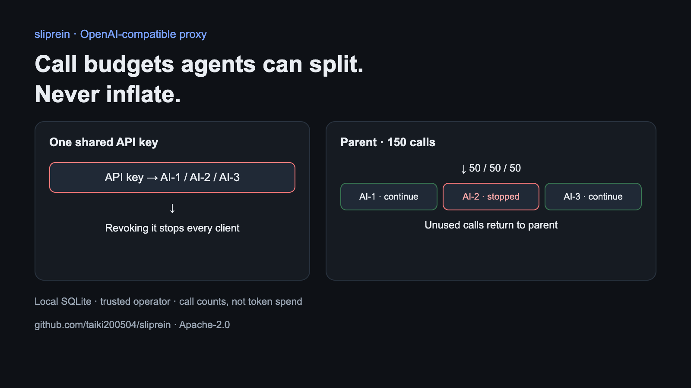

[English](README.md) | [日本語](README.ja.md) | [简体中文](README.zh-CN.md)

# sliprein

Call budgets your AI agents can split — but never inflate.

A local OpenAI-compatible proxy with conserved per-agent call budgets. Prototype: no production users or independent security audit yet.



- Split a parent budget into smaller agent budgets.
- Stop one branch; return its unused calls.
- Other branches keep their own allocations.

## Quickstart

```sh
# Node.js 24.x; UPSTREAM_API_KEY must already be set privately
npm ci --omit=dev
npm run -s sliprein -- issue agent-1 --calls 100
npm run -s sliprein -- token agent-1
npm run -s sliprein -- serve --upstream https://api.openai.com
```

Use the token printed by the third command as your SDK API key and `http://127.0.0.1:8787/v1` as `base_url`. Never give agents the upstream API key. The package is not published to npm; use this checkout. Runtime dependencies: zero. The BSV SDK is development-only.

## Virtual keys and sliprein

Virtual-key gateways already offer per-key revocation and shared or hierarchical budgets. sliprein focuses on **an agent splitting its own remaining calls**: children cannot increase the total, scope or expiry. Stopping a subtree returns unused calls to its parent once. This is a workflow distinction, not a claim of unique revocation.

## CLI

```sh
npm run -s sliprein -- delegate agent-1 worker --calls 25
npm run -s sliprein -- token worker
npm run -s sliprein -- stop worker
npm run -s sliprein -- status
```

## Trust boundary and limits

Trust the operator, host, local SQLite state, TLS boundary and provider. The operator can edit budgets and access upstream credentials. Bearer tokens prove possession, not agent identity or intent. This does not prevent prompt injection, sandbox tools, cap token spend or retract admitted requests. Upstream failures still count; existing streams continue after a stop. Upstream bodies pass through, including any sensitive data the provider returns.

## Scaling limits

One process and a local SQLite database; synchronous durable writes serialize admission and block the event loop. **No supported horizontal scaling or shared network filesystem.** 10,000 independent installations have separate state; this is not evidence of 10,000 users on one server. Defaults: 64 KiB request bodies, 200 requests/IP/second, 100 admissions/agent/second, 200 active requests, 512 client sockets, 64 upstream sockets, 120s upstream total deadline (connect through response body). Programmatic options can tune limits; benchmark before raising them. TLS, global/DDoS controls, disk monitoring, backups and patch rollout remain operator responsibilities.

[Audit / 实测 / 実測](docs/SCALING_AUDIT.md) · `node scripts/load.mjs` (50 / 200 concurrent clients, local mock upstream; rps, p50/p99, errors). Results are local observations, not an SLA.

## FAQ

**What routes work?** `POST /v1/chat/completions`, `/v1/embeddings`, `/v1/responses`, and `GET /v1/models`; JSON and SSE. Other routes and query strings are rejected. The configured upstream may have a plain path prefix, never `/v1` for the standard OpenAI origin.

**How do I stop or delegate?** Local CLI below; token-authenticated `POST /delegate` accepts `name`, `calls`, optional `scope` and `expiresAt`. `POST /stop` with `{}` stops the caller subtree. These management calls do not consume provider quota. Scope bits: chat 1, embeddings 2, responses 4, models 8; maximum ancestry depth 8.

**Can I expose it remotely?** Default bind is `127.0.0.1`. Explicit `--host 0.0.0.0` opts into all IPv4 interfaces and prints a warning. Put TLS and access control at a trusted reverse proxy. Never expose the private state directory (`~/.sliprein`, override with `--state`). Do not share it with agents.

**What does /healthz check?** Local process liveness only, without credentials or quota debit; not provider readiness or database integrity.

**How long are receipts kept?** Live tranche receipts/nonces are never pruned. After expiry + 24h, periodic bounded cleanup removes them. Export before that if audit evidence is needed. Tranche/settlement metadata, WAL size and backups still need a retention policy. A token can be replayed until expired, stopped or exhausted.

**Are errors private?** Gateway errors are generic and client authorization/hop-by-hop headers never go upstream. Provider responses are passed through; their disclosure policy is outside this boundary.

Existing stores created with permissive database modes must be backed up and made private by their trusted owner before upgrading; unsafe database files and symlinks are refused.

[Security](SECURITY.md) · [Contributing](CONTRIBUTING.md) · [Changelog](CHANGELOG.md) · [Release / provenance](docs/RELEASING.md) · Apache-2.0

## Research

Optional [BSV authority UTXO research](research/authority-utxo/) studies covenant-backed authority. It is separate from the default SQLite proxy and does not make this release trustless. Real-network finality, external API effects and adversarial assumptions remain unresolved.
