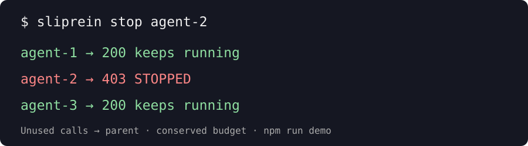
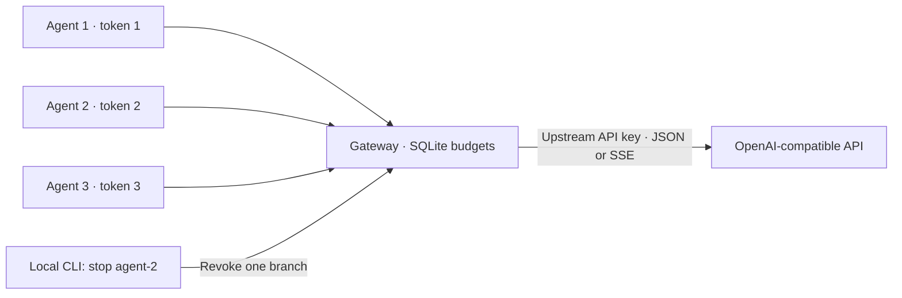

Call budgets your AI agents can split — but never inflate.

Agents hand slices of their remaining calls to sub-agents. Children can never add up to more than the parent or widen its scope. Stop one branch: it gets a 403 on its next call, its unused calls flow back to the parent, and the siblings keep running.

The proxy operator counts calls; this is **not trustless**.<br>
Stop affects only the next call through this proxy: shell, payments and MCP outside it keep working, and admitted calls cannot be undone.<br>
There are **no production users yet**.

| Budget workflow | Who allocates it? | What is conserved? |
| --- | --- | --- |
| Independent virtual keys in LiteLLM / Bifrost / Portkey | An administrator issues separate keys | Each configured key budget; some products also support shared or hierarchical budgets |
| sliprein | An agent splits its own remaining calls using its token | Parent + child allocations never increase; scope can only narrow; stopping a branch returns unused calls to its parent |

This comparison is about the allocation workflow, not a claim that other gateways lack per-key revocation or shared budgets. Isolated stopping by itself is established functionality. See the [LiteLLM key/budget documentation](https://docs.litellm.ai/docs/proxy/users) and [Bifrost virtual-key documentation](https://docs.getbifrost.ai/features/governance/virtual-keys).



**30-second GIF:** [recording tape](demo/demo.tape). Run `npm run demo` for the offline demonstration: split 150 calls into three slices, stop one injected agent, reclaim its unused slice, and keep the other two running. VHS is optional; a GIF has not been generated yet.

An OpenAI-compatible gateway. Change your SDK's `base_url` and API key to an agent token; only the gateway holds the upstream API key. The package name is **sliprein**, and it has not been published to npm. Use this checkout until publication.

## Quickstart

Node.js 24 or later. From this checkout, with `UPSTREAM_API_KEY` already set in your environment:

```sh
npm ci --omit=dev && npm run -s sliprein -- issue agent-1 --calls 100
npm run -s sliprein -- token agent-1
npm run -s sliprein -- serve --upstream https://api.openai.com
```

Copy the second command's output into your client's API key configuration. Set `base_url` to `http://127.0.0.1:8787/v1`. Keep tokens private. The upstream argument is the **origin**, without `/v1`; a path prefix is allowed for upstream gateways. The default production install uses only Node.js built-ins and never imports or installs `@bsv/sdk`; that SDK is a development dependency for the separately packaged research tests.

`npm run -s sliprein -- <command>` runs the checkout. The packed or published package also exposes the `sliprein` bin; a clean consumer installation is verified in CI. Plain `npx sliprein` is intended only after the package is published.

```python
from openai import OpenAI
client = OpenAI(base_url="http://127.0.0.1:8787/v1", api_key="<agent-token>")
for event in client.chat.completions.create(
    model="your-model", messages=[{"role": "user", "content": "Hello"}], stream=True
):
    print(event)
```

## How it works



Every admitted request atomically consumes one call. Tokens are random 256-bit secrets, stored as SHA-256 digests and bound to a tranche and agent public key. Signed request headers remain supported. Bearer clients prove token possession, not possession of the agent's private key; bearer receipts are gateway records, not agent signatures.

Supported routes: `POST /v1/chat/completions`, `POST /v1/embeddings`, `POST /v1/responses`, and `GET /v1/models`. JSON and SSE responses preserve upstream status and stream with backpressure. This is a bounded compatibility surface, not every OpenAI endpoint. Request bodies are limited to 64 KiB. Routes and query strings outside this list are rejected.

## CLI

```sh
npm run -s sliprein -- issue coordinator --calls 1000 --ttl 86400 --scope 15
npm run -s sliprein -- delegate coordinator worker --calls 100
npm run -s sliprein -- token worker
npm run -s sliprein -- stop worker
npm run -s sliprein -- status
```

Scope is a bitmask: chat `1`, embeddings `2`, responses `4`, models `8`. Delegation reserves calls from the parent's remaining budget; children inherit or narrow scope and expiry. Stopping a branch stops its descendants and atomically returns all unused calls in that subtree to the immediate parent, once. Siblings keep their allocations. Stopping a root retires its unused calls because it has no parent. Existing signed `/bind` and `/stop` endpoints remain available through the original programmatic server; proxy mode forwards only the four upstream routes and handles token-authenticated `/delegate` and `/stop` locally.

State defaults to `~/.sliprein` (derived from the package name); use `--state <directory>` on every command to select another store. The directory and gateway key are private to the local OS user. Run management commands as that user. Existing state from before explicit parent metadata is linked by its saved ancestry; allocations already stopped in that older format remain retired. The proxy binds to loopback; place TLS and authentication at your deployment boundary before exposing it to another machine. There is no remote administration endpoint.

## Agent-controlled splitting

Use the agent token to split a remaining slice without the administrator's credentials:

```sh
curl http://127.0.0.1:8787/delegate -H "Authorization: Bearer $AGENT_TOKEN" -H 'Content-Type: application/json' -d '{"name":"worker-1","calls":25,"scope":1}'
curl http://127.0.0.1:8787/stop -H "Authorization: Bearer $CHILD_TOKEN" -H 'Content-Type: application/json' -d '{}'
```

`/delegate` returns a child token once; keep it private. `calls` must fit within the caller's remaining slice. Optional `scope` is a subset bitmask and `expiresAt` cannot exceed the caller's Unix expiry. Parent identity comes from the token and cannot be supplied in the body. `/stop` stops the token's own subtree and returns its unused calls to its parent. These local management requests do not consume upstream calls and are rate limited. There is no remote root-issuance or arbitrary-agent administration API.

## Performance and tests

`npm run bench` measures two distinct paths: **admission only** (bearer lookup, scope/expiry check and durable SQLite debit), and **end-to-end proxy** (local HTTP client → proxy → mock JSON upstream → full response consumption). It does not call a real provider. Configure `BENCH_SAMPLES` and `BENCH_CONCURRENCY`; defaults are 500 samples per path, 50 warmups and concurrency **1**. SQLite uses WAL and `synchronous=FULL` on a local temporary disk.

| Measurement | p50 | p99 |
| --- | ---: | ---: |
| Admission only | 0.082 ms | 1.112 ms |
| Proxy end-to-end, including mock upstream | 0.463 ms | 2.130 ms |

Measured on Apple M5, 10 logical CPUs, 16 GiB RAM, macOS/Darwin 27.2.0 arm64, Node.js 24.16.0; loopback HTTP with keep-alive, concurrency 1, 500 samples, after 50 warmups. Both rows are local measurements of the same configuration, not production latency or an SLA. `scripts/bench.mjs` prints machine and concurrency metadata alongside both distributions. Historical signed/experimental-chain measurements remain in [Japanese benchmark notes](docs/ja/PRACTICAL_V1_RESULT.md).

CI at implementation commit `e074607` ran **165 tests: 165 passed, 0 failed**, including conservation and agent-management regressions. Run `npm test` for the full suite or `node --test --test-concurrency=1 cli/cli.test.mjs gateway/proxy.test.mjs` for the focused proxy/CLI checks.

## FAQ: trust and limits

**What do I trust?** The gateway operator, host, database, TLS boundary, and upstream provider. An operator or an attacker who controls the host can alter quotas or obtain the upstream key. SQLite is the authority in the default mode.

**Does this stop prompt injection?** It limits future admitted calls after a local stop and bounds call counts. It does not inspect model intent, prevent all injections, sandbox tools, or retract requests already admitted. A stream already started continues after stop. Route scope and call quotas do not limit token spend, model choice, data contents, tools outside the gateway, or an agent's direct access to other credentials. Do not give agents the upstream key.

**What happens on upstream errors?** An admitted call is counted even if the upstream fails. Redirects are rejected and never followed. Tokens never go upstream; only an allowlist of response headers returns to clients. A stopped or exhausted agent receives 403. No network or provider error details are exposed by gateway-generated errors; upstream response bodies pass through and remain subject to the provider's disclosure policy.

**Can I share the state directory?** Only among processes on the same trusted host and OS account. Do not use a network filesystem, copy live databases, or let agents access the directory. A token can be stolen and replayed until stopped, expired, or exhausted. There is no billing-grade exactly-once guarantee across external provider effects.

## Development and security

`npm ci`, `npm test`, `npm run demo`. See [contributing](CONTRIBUTING.md) and [security](SECURITY.md). Apache-2.0 licensed. This repository is a prototype and has not received an independent security audit.

## Experimental trustless mode

[Authority UTXO research](research/authority-utxo/) explores an **experimental trustless mode** using BSV covenants. It is optional research, not the default proxy trust model or a production trustlessness claim. Real-network finality, external API effects, operator honesty, and attack assumptions remain unresolved; historical red-team reports document four rounds of failures and limitations in [Japanese research notes](docs/ja/REDTEAM_2026-11-16.md).
