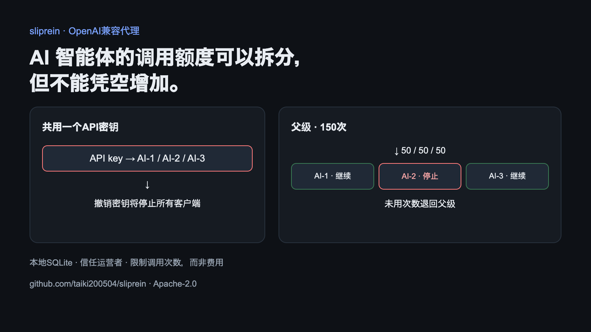

[English](README.md) | [日本語](README.ja.md) | [简体中文](README.zh-CN.md)

# sliprein

AI 智能体的调用额度可以拆分，但不能凭空增加。

放在 OpenAI 兼容 API 前面的本地调用次数代理。目前是原型，尚无生产用户，也未接受独立安全审计。



- 把父级剩余额度分给子智能体。
- 停止一个分支，将未用额度退回父级。
- 其他分支保留自己的额度并继续运行。

## 快速开始

```sh
# Node.js 24.x; UPSTREAM_API_KEY must already be set privately
npm ci --omit=dev
npm run -s sliprein -- issue agent-1 --calls 100
npm run -s sliprein -- token agent-1
npm run -s sliprein -- serve --upstream https://api.openai.com
```

将第三条命令输出的令牌设为 SDK API 密钥，将 `base_url` 设为 `http://127.0.0.1:8787/v1`。不要把上游 API 密钥交给智能体。尚未发布到 npm，请从此检出目录运行。运行时额外依赖为零；BSV SDK 仅用于开发。

## 与虚拟密钥的区别

现有虚拟密钥网关也支持单独撤销、共享或分层预算。sliprein 关注**智能体自行拆分剩余调用次数**：子级不能增加总量、权限或有效期。停止子树时，未用次数只退回父级一次。这是分配流程的区别，并非声称单独撤销是独有功能。

## CLI

```sh
npm run -s sliprein -- delegate agent-1 worker --calls 25
npm run -s sliprein -- token worker
npm run -s sliprein -- stop worker
npm run -s sliprein -- status
```

## 信任边界与限制

需要信任运营者、主机、本地 SQLite、TLS 边界和上游服务商。运营者能够修改额度并读取上游密钥。持有令牌不等于证明身份或意图。它不能阻止提示注入、隔离工具、限制 token 费用或撤回已接纳的请求。在收到上游响应头之前的连接失败或超时会退回一次额度；收到响应头后的失败（错误状态、重定向或流中断）仍计一次。停止前已开始的流继续运行。上游返回的敏感内容也会原样通过。

## 规模上限

仅支持单进程和本地 SQLite。同步持久化写入串行执行并阻塞事件循环。**不支持水平扩容或共享网络文件系统。** 一万个独立安装各自保存状态，不代表单机支持一万用户。默认：请求体64 KiB、每IP每秒200次、每智能体每秒100次接纳、200个处理中请求、512个客户端连接、64个上游连接、上游总期限120秒（从连接到完整响应体）。程序接口可调整限制，提高前先测量。TLS、全局攻击防护、磁盘监控、备份和升级由运营者负责。

[Audit / 实测 / 実測](docs/SCALING_AUDIT.md) · `node scripts/load.mjs` (50 / 200 concurrent clients, local mock upstream; rps, p50/p99, errors). Results are local observations, not an SLA.

## 常见问题

**支持哪些 API？** `POST /v1/chat/completions`、`/v1/embeddings`、`/v1/responses` 和 `GET /v1/models`，支持 JSON 和 SSE；拒绝其他路径和查询字符串。上游可设置普通路径前缀，标准 OpenAI 地址不加 `/v1`。

**如何拆分或停止？** 使用下方 CLI，或以令牌认证调用 `POST /delegate`（`name`、`calls`，可选 `scope`、`expiresAt`）和 `POST /stop`（`{}`）。管理请求不消耗上游次数。权限位：chat=1、embeddings=2、responses=4、models=8；祖先深度最多8。

**能对外开放吗？** 默认只监听 `127.0.0.1`。显式传入 `--host 0.0.0.0` 才监听全部 IPv4 接口，并显示警告。请在可信反向代理配置 TLS 和访问控制。不要把 `~/.sliprein`（可用 `--state` 修改）交给智能体。

**/healthz 检查什么？** 只检查进程存活，不需要凭据、不扣额度；不检查上游可用性或数据库完整性。

**记录保存多久？** 有效额度的收据和 nonce 不删除。到期24小时后，定期分批清理。如需审计证据，请提前导出。额度与结算元数据、WAL 和备份仍需独立保留策略。令牌可重放直到停止、到期或耗尽。

**错误会泄露秘密吗？** 代理生成通用错误，不向上游转发客户端认证或 hop-by-hop 头。上游响应正文原样通过，上游自身的披露政策不在此边界内。

旧版数据库权限过宽时，应由可信所有者先备份并收紧权限，再升级。拒绝权限过宽的数据库及符号链接。

[Security](SECURITY.md) · [Contributing](CONTRIBUTING.md) · [Changelog](CHANGELOG.md) · [Release / provenance](docs/RELEASING.md) · Apache-2.0

## 研究

可选的 [BSV authority UTXO研究](research/authority-utxo/)探索基于 covenant 的权限管理。它与默认 SQLite 代理分离，并不使此版本变成无需信任的系统。真实网络最终性、外部 API 副作用及对抗假设仍有未解决问题。

使用 `sliprein token worker --ttl 3600` 可指定令牌有效期（秒，不能超过代理额度有效期）；省略时使用额度有效期。`sliprein token revoke worker` 撤销该代理的所有现有令牌，下次调用返回401，不停止其他代理或额度；之后可重新签发令牌。

直接公开服务时，保持 `trustProxy: false`（CLI默认值，`--trust-proxy false`），忽略转发头；IPv6按/64合并限流。仅在可信反向代理后方显式启用 `--trust-proxy true`（API为 `trustProxy: true`），使用 `X-Forwarded-For` 最后一跳的有效IP。代理必须覆盖或在末尾添加真实客户端IP，并禁止客户端直接连接网关。请求体读取总时限默认为5秒，可通过 `--body-timeout-ms 5000`（API为 `bodyTimeoutMs`）调整；超出大小限制时返回413并关闭连接。
